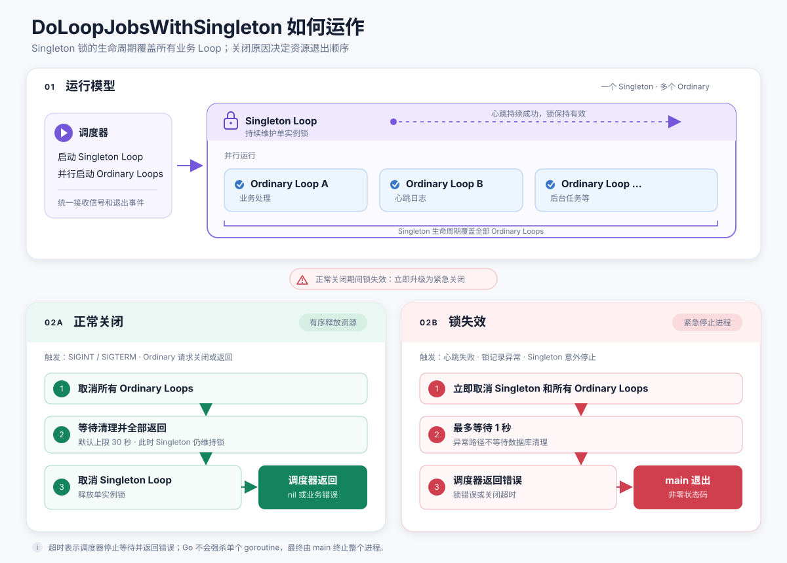

# `DoLoopJobsWithSingleton` 使用指南

`DoLoopJobsWithSingleton` 用于同时运行一个单实例锁 Loop 和多个普通业务 Loop。它保证正常关闭时先停止普通 Loop，最后释放单实例锁；如果单实例锁失效，则立即取消所有 Loop，并限制紧急退出时间。

旧的 `DoLoopJobs` 继续保留以兼容已有程序。新程序或需要单实例锁生命周期管理的程序应使用本文介绍的新接口。

## 核心模型

新调度器把 Loop 分为两类：

- **Singleton Loop**：维护单实例锁。它的生命周期必须覆盖所有普通 Loop。
- **Ordinary Loop**：业务处理、心跳日志、后台任务等普通 Loop。



基本调用形式：

```go
err := dc.DoLoopJobsWithSingleton(
	singletonHandler.LoopWithContext,
	dc.FlushWithContext,
	processor.LoopWithContext,
)
```

第一个参数必须是 Singleton Loop，后面的可变参数都是普通 Loop。所有 Loop 的类型都是：

```go
type ContextLoop func(ctx dc.LoopContext) error
```

## 在 `main` 中接入

调度器本身不会调用 `os.Exit`。它在异常或超时时返回错误，由 `main` 记录错误并以非零状态退出。

推荐同时使用 `RecoverExitCode`，避免 main goroutine 的 panic 被恢复后错误地以状态码 0 退出：

```go
package main

import (
	"os"

	dc "github.com/LukeEuler/dolly/common"
	"github.com/LukeEuler/dolly/log"
)

func main() {
	os.Exit(runMain())
}

func runMain() (exitCode int) {
	defer dc.RecoverExitCode(&exitCode)

	if err := run(); err != nil {
		log.Entry.WithError(err).Error("application stopped abnormally")
		return 1
	}
	return 0
}

func run() error {
	// 配置初始化和依赖创建省略。

	return dc.DoLoopJobsWithSingleton(
		singletonHandler.LoopWithContext,
		dc.FlushWithContext,
		processor.LoopWithContext,
	)
}
```

正常关闭且清理成功时，调度器返回 `nil`；锁失效、Loop 异常、清理失败或关闭超时时返回非 `nil` 错误，因此守护进程可以根据退出码决定是否重启。

## 编写普通 Loop

普通 Loop 通过 `ctx.Done()` 接收关闭通知：

```go
func (p *Processor) LoopWithContext(ctx dc.LoopContext) error {
	timer := time.NewTimer(0)
	defer timer.Stop()

	for {
		select {
		case <-ctx.Done():
			return p.stop()

		case <-timer.C:
			if err := p.work(ctx); err != nil {
				return err
			}
			timer.Reset(p.loopInterval)
		}
	}
}
```

收到取消后，Loop 应停止接受新任务，完成必要清理，然后尽快返回。数据库、HTTP、RPC 等可能阻塞的操作也应尽量接收这个 context，才能及时中断。

### 主动请求正常关闭

每个普通 Loop 都可以主动请求整个程序关闭：

```go
if reachedMaxHeight {
	ctx.RequestShutdown(nil)
	return nil
}
```

调用 `RequestShutdown(nil)` 表示正常关闭。调度器会通知所有普通 Loop，但会继续维持单实例锁，直到普通 Loop 全部返回。

如果发起者还需要清理，可以先发通知，再等待取消信号：

```go
ctx.RequestShutdown(nil)
<-ctx.Done()
return cleanup()
```

同一个 Loop 多次调用 `RequestShutdown` 是幂等的，只有第一次有效。不要关闭 `ctx.Done()`；该 channel 归调度器所有。

### 报告普通 Loop 异常

普通 Loop 可以直接返回错误：

```go
if err := p.work(ctx); err != nil {
	return fmt.Errorf("process block: %w", err)
}
```

也可以先通知其他 Loop，再进行自己的清理：

```go
if err := p.work(ctx); err != nil {
	err = fmt.Errorf("process block: %w", err)
	ctx.RequestShutdown(err)
	<-ctx.Done()
	return p.stop()
}
```

调用 `RequestShutdown(err)` 后，错误已经由调度器记录，Loop 返回值只需要报告后续清理产生的新错误。

普通 Loop 异常仍采用正常的资源关闭顺序：先停止所有普通 Loop，最后停止 Singleton Loop；调度函数最终返回错误。

## Singleton Loop

`SingletonHandler` 已提供适配新调度器的方法：

```go
singletonHandler.LoopWithContext
```

它具有以下行为：

- context 正常取消时，释放数据库中的锁并关闭数据库连接；
- 任意一次心跳更新失败，立即判定锁失效，不进行重试；
- `RowsAffected` 不是 1 时，同样立即判定锁失效；
- 锁失效后立即请求紧急关闭，不在异常路径等待数据库清理；数据库资源由随后退出的进程回收。

Singleton Loop 在未收到正常停止通知前返回，即使返回值是 `nil`，也会被视为锁已失效，并产生 `ErrSingletonLoopStopped`。

## 关闭顺序与超时

### 正常关闭

以下情况触发正常关闭：

- 收到 `SIGINT` 或 `SIGTERM`；
- 普通 Loop 调用 `RequestShutdown`；
- 普通 Loop 返回。

顺序如下：

```text
取消所有普通 Loop
    ↓
等待普通 Loop 清理并全部返回
    ↓
取消 Singleton Loop
    ↓
释放单实例锁并返回
```

默认最多等待 30 秒。超过时间后返回 `LoopJobsShutdownTimeoutError`，调用方应以非零状态退出。

### 锁失效

Singleton Loop 请求关闭或意外返回时，调度器进入紧急关闭：

```text
锁失效
    ↓
立即取消 Singleton Loop 和所有普通 Loop
    ↓
最多等待 1 秒
    ↓
返回锁错误或关闭超时错误
```

如果程序原本正在正常关闭，期间又发生锁失效，调度器会立即升级为紧急关闭，并从锁失效时开始应用 1 秒期限。

Go 不能安全地强杀单个 goroutine。所谓“最多等待 1 秒”是指调度器在 1 秒后停止等待并返回超时错误，随后由 `main` 调用 `os.Exit(1)` 终止整个进程。

## 自定义超时

需要调整超时时间时，使用带 Options 的入口：

```go
err := dc.DoLoopJobsWithSingletonOptions(
	dc.SingletonLoopJobsOptions{
		GracefulShutdownTimeout:         20 * time.Second,
		SingletonFailureShutdownTimeout: time.Second,
	},
	singletonHandler.LoopWithContext,
	dc.FlushWithContext,
	processor.LoopWithContext,
)
```

两个字段的零值分别使用默认值：

| 配置 | 默认值 | 用途 |
| --- | ---: | --- |
| `GracefulShutdownTimeout` | 30 秒 | 正常关闭时等待所有 Loop 清理 |
| `SingletonFailureShutdownTimeout` | 1 秒 | 锁失效后的紧急停止上限 |

配置负数会直接返回参数错误。

## 判断关闭超时

可以使用 `errors.Is` 判断调度器是否因超时返回：

```go
err := dc.DoLoopJobsWithSingleton(
	singletonHandler.LoopWithContext,
	dc.FlushWithContext,
	processor.LoopWithContext,
)
if errors.Is(err, dc.ErrLoopJobsShutdownTimeout) {
	log.Entry.WithError(err).Error("loop shutdown timed out")
}
return err
```

超时错误会同时包装最初的关闭原因。例如锁心跳失败后又发生 1 秒超时，既可以匹配 `ErrLoopJobsShutdownTimeout`，也可以通过错误链获得原始锁错误。

## 从旧 Loop 迁移

旧签名：

```go
func Loop(shutdown chan struct{})
```

新签名：

```go
func LoopWithContext(ctx dc.LoopContext) error
```

迁移时逐项检查：

1. 把 `<-shutdown` 改为 `<-ctx.Done()`。
2. 把 `close(shutdown)` 改为 `ctx.RequestShutdown(nil)` 或 `ctx.RequestShutdown(err)`。
3. 为 Loop 增加 `error` 返回值，并向上返回异常。
4. 将耗时 I/O 尽量改成支持 context 的调用。
5. `main` 改为 `os.Exit(runMain())`，并使用 `RecoverExitCode`。
6. 调用入口改为 `DoLoopJobsWithSingleton`，第一个参数固定传 Singleton Loop。

不要尝试用适配器继续让多个旧 Loop 共享并关闭同一个 `chan struct{}`。新接口分离了“接收取消”和“请求关闭”，正是为了消除重复关闭 channel 的 panic 和并发竞态。
